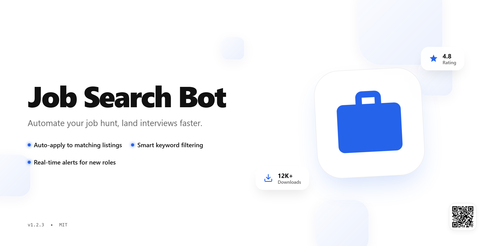

# 🚀 Job Search Bot – Community-Powered Job Finder for Telegram

### 📦 PowerShell Install Button

    

---

A friendly, community-driven Telegram bot that quietly watches job boards for you, filters every listing against your own profiles and keywords, and pings you the moment something new or freshly reopened appears. Built with job seekers in mind, it goes beyond simple alerts by helping you tailor your resume and cover letter for each match, so applying takes minutes instead of evenings. Everything runs on plain RSS feeds with no accounts or logins, keeping the whole experience open and accessible to anyone hunting for their next role.

## 📋 System Requirements

- Windows 10 or Windows 11
- PowerShell 5.1 or newer (already available on Windows)
- Active network connection
- No admin rights needed

## Features

🔎 **Smart multi-source search** — Job Search Bot scans public feeds for matching postings, so you don't have to keep a dozen tabs open just to catch the good ones.

- 🎯 **Your profiles, your rules** — Set up search profiles with your own keywords, title requirements, and exclusion words. Each profile searches independently, so frontend roles and embedded roles never get mixed up. No regex needed — plain keywords are enough.

- 🔔 **Instant push notifications** — New postings land in your chat the moment they appear. Reopened jobs get flagged too, so you never miss a second chance at a role you liked.

- ⭐ **Priority marking** — Jobs matching your favorite keywords get highlighted and delivered first, so the most relevant openings are always at the top of your feed.

- 📄 **Resume tailoring** — Every push comes with a button that adapts your base resume to the specific job description and returns a ready PDF in seconds. Strictly facts from your resume — nothing invented.

- ✉️ **Cover letter generation** — A second button drafts a short, tailored cover letter for the same posting and sends it as plain text. Both results are cached per job, so re-clicking is instant and costs nothing extra.

- ✅ **Application tracking** — Mark jobs as applied or not interested right from the push. Gentle reminders nudge you about postings you haven't acted on yet, and a weekly digest summarizes your activity broken down by profile.

- 🌙 **Quiet hours** — No notifications at night. Anything that arrives during your off-hours piles up and gets delivered as a morning digest when quiet hours end.

- 🗂 **Pending list with checkboxes** — Review everything awaiting action in one message. Toggle jobs on and off, open them directly, or dismiss a whole group with a single tap. Large lists are paginated automatically.

- 🔁 **Reconsider skipped jobs** — Changed your mind? A dedicated command brings back everything you marked as not interested, and one tap returns it to your pending list.

- ⚙️ **Settings from chat** — Adjust reminder timing, quiet hours, digest frequency, and more with simple commands. Changes apply immediately — no restart, no redeploy.

- 💾 **Automatic backups** — Your state gets backed up to the chat on a schedule and restored automatically after a restart. Nothing to forward or restore by hand.

- 🧩 **Profile management in chat** — Add or remove search profiles through a step-by-step wizard. Your profile set survives restarts and disk resets.

- 🗣 **Bilingual interface** — Ukrainian and English, switchable with a single setting, so the bot speaks your language.

- 🛡 **Feed health warnings** — If a source goes silent, you get one clear notice instead of wondering whether the job market dried up or the feed broke.

- 🤝 **Built for the community** — Every feature grew out of real job-hunting pain points shared by users. Suggestions and pull requests are always welcome — this bot gets better because people like you keep pushing it forward.

## Commands

Here's a friendly, complete set of commands to get you moving. Every one of them works in both the Telegram chat with the bot and in the group where you've added it — just type them as shown.

### 🚀 Getting started
- **`/start`** — wakes the bot up, shows a short welcome, and confirms your chat is wired in correctly.
- **`/help`** — the full command cheat sheet, always one tap away. If you ever forget a flag or a key name, start here.
- **`/status`** — a quick health check: is the feed reader alive, how many profiles are active, when was the last sweep, and whether your tailoring keys are configured.

### 🔎 Searching & profiles
- **`/search <keywords>`** — runs an ad-hoc lookup right now, without waiting for the next scheduled sweep. Great for testing how a phrase behaves before you commit it to a profile.
- **`/profiles`** — lists every search profile you've built, with a delete button under each one.
- **`/addprofile`** — a step-by-step wizard that walks you through name → resume key → keywords → title must-haves → exclusions → seniority filter → experience cap. No regex, just plain words. `/cancel` bails out at any point.
- **`/editprofile`** — tweak an existing profile's keywords or filters without rebuilding it from scratch.
- **`/keywords`** — prints the exact terms each profile is currently watching, so you can spot duplicates or dead weight at a glance.

### 📥 Reviewing matches
- **`/pending`** — one tidy message listing every posting still awaiting your decision, with ⬜/✅ toggle buttons you can tap right there. Long lists paginate automatically, and a "Dismiss all 'Other'" button clears the non-priority tail in one tap.
- **`/skipped`** — everything you previously waved off, shown the same way. Tap a title to bring it back into `/pending` if you change your mind or the role reopens.
- **`/applied`** — a running log of postings you've marked as applied to, useful for a quick sanity check before an interview round.

### 📄 Tailoring & documents
- **`/tailor`** — regenerate a tailored resume for a specific posting on demand; the result arrives as a ready-to-send document.
- **`/coverletter`** — same idea, but produces a short, human-sounding cover letter as plain text.
- **`/resume`** — shows which base resume is currently bound to each profile, and lets you swap the binding without touching any files.

### 📊 Insight & housekeeping
- **`/stats`** — postings received versus applications sent over your chosen window, broken down per profile.
- **`/digest`** — pulls the weekly summary on demand instead of waiting for the scheduled run.
- **`/settings`** — displays your live values for reminder timing, quiet hours, stats window, backup cadence, and list limits, flagging anything you've changed from the defaults.
- **`/set <key> <value>`** — updates any of those settings instantly — no restart, no redeploy. Invalid keys or out-of-range values are politely rejected and your current setting stays put.
- **`/backup`** — sends you a snapshot of your bot state right away, pinned in the chat for safekeeping.
- **`/quiet`** — a shortcut for checking or toggling your night-time pause window without digging through `/settings`.

### 💬 Everyday conveniences
- **`/now`** — forces an immediate feed sweep and pushes anything fresh, bypassing the normal interval.
- **`/mute`** / **`/unmute`** — pause or resume push notifications entirely while you're away; your history and profiles stay intact.
- **`/lang`** — switch the bot's interface language between the supported options.

### 🌱 A few friendly notes
- Buttons are your friend: every push carries inline actions for tailoring, marking applied, or dismissing — no need to retype a command.
- Commands accept plain keywords, so phrase them the way you'd describe the role to a colleague. The bot builds the underlying queries for you.
- Everything you change through commands is stored alongside the rest of your state, so a restart won't undo your setup.
- Made a typo? Most commands are forgiving and will suggest the closest match rather than scolding you.

Questions, ideas, or a command you wish existed? The community shapes this bot — chime in and it might just land in the next release.

## Configuration

Configuration here is intentionally lightweight — a handful of settings, one seed file, and everything else handled conversationally inside the bot. There's nothing to compile, no schema to memorize, and no vendor lock-in: sensible defaults work out of the box, and you can fine-tune as your search evolves.

**The config file** holds your baseline behavior. Populate `bot/config.py` with your initial set of search profiles, the global exclusion list (roles you never want to see on any profile), the maximum posting age in days, and a first-run cap so the bot doesn't flood you the moment it wakes up. Everything in there is plain, readable values — no regex wizardry required.

**Secrets and runtime toggles live in environment variables.** Your Telegram bot token and target chat ID are the minimum required to get pushes flowing. If you want the resume and cover-letter tailoring pipeline active, add an API key for the language model provider; without it the buttons gracefully report the feature is off while push notifications continue unaffected. Optional variables cover quiet-hour boundaries and timezone, digest scheduling, backup cadence, feed-failure alert thresholds, interface language, and the applicant name used when naming generated PDFs. Every optional knob has a documented default, so a minimal setup is a valid setup.

**Profiles are seeded, then owned by you.** That config file is only the starting point: on first boot its profiles are copied into the bot's persisted state, and from that moment the state is the single source of truth. Add, edit, or remove profiles with `/profiles` and `/addprofile` — the wizard walks you through naming a profile, wiring it to a base resume, supplying keyword feeds, title filters, exclusions, and seniority/experience bounds. `/settings` and `/set` let you tweak reminder windows, quiet hours, stats periods, and list limits live, with no restart or redeploy.

**Resume tailoring is configurable too.** Drop your real resumes into the local, git-ignored module alongside the bundled example, and the bot will pick them up automatically. Swap the language model or tune its cost profile by changing a single variable. Cache behavior is automatic, so repeated taps on the same job never trigger redundant generation.

**Persistence is your choice.** For casual use, the built-in backup-to-chat and auto-restore dance keeps your history intact across restarts. If you want truly set-and-forget durability, point the bot at a hosted realtime database and your state survives redeploys with zero manual steps. There's no wrong answer — start simple and upgrade whenever you like.

## FAQ

**Is this bot open to everyone?**
The bot itself is fully accessible to each user through verified distribution kept by the maintainers, no strings attached. There's no paywalled tier and no hidden upgrade path — the entire feature set described here ships complete. That said, a couple of the integrations (the resume/cover-letter tailoring engine and optional persistence backends) rely on third-party services with their own usage limits, so keep an eye on those if you're heavy on the buttons.

**Which job boards does it actually cover?**
Job Search Bot reads public feeds and turns them into matched postings automatically. By default it pulls from the Ukrainian board and one aggregator, and the architecture lets you point keywords at additional feeds without touching the core logic. If a source goes quiet for several consecutive attempts, you'll get a single heads-up rather than silence — see the configuration notes.

**Do I need coding skills to add a new search profile?**
Not at all. The `/profiles` command lists your active searches, and `/addprofile` walks you through a step-by-step wizard: name, resume key, keywords, title words, exclusions, seniority preference, experience cap. Everything is plain words — no regex, no redeploy. `/cancel` bails out at any point, and profile changes immediately become part of your saved state.

**What happens to my application history if the server restarts?**
The bot is built to be tough against wipes. It periodically ships a state snapshot straight into your chat, pins it, and on startup auto-restores from that pinned file when the local copy is blank. You can also `/backup` manually any time, or forward a previously saved snapshot back to the bot to restore it. Nothing ever leaves your own chat.

**Can I tweak reminders and quiet hours on the fly?**
Yes — `/settings` shows eight live parameters with defaults marked, and `/set <key> <value>` updates them instantly, no restart required. Values are persisted in your state file, so they survive redeploys along with your application history. Environment variables still provide the initial values until the first `/set` for that key.

**How does the notification flow handle a flood of postings?**
New and reopened postings are batched — quiet hours collect everything and release it as one digest header plus individual pushes, each carrying its own action buttons. Priority jobs are visually flagged and delivered first. Long lists are paginated so the keyboard never gets rejected, and you can dismiss an entire non-priority group in one tap.

**Why do some postings show up once when they exist on two boards?**
The deduplication layer spots identical titles across sources and merges them into a single push labelled with both origins. That way you don't get double reminders, and clicking "Applied" once closes the match for every source that reported it.

**Is the tailoring engine required to use the bot?**
No. Without an API key configured, the tailoring buttons simply respond that the feature is disabled, while the whole search, filtering, reminder, and stats pipeline keeps running normally. If you do enable it, results are cached per posting so repeat clicks are instant and don't trigger new generation — there's a dedicated regenerate button if you want a fresh take.

**Where do I go if something looks off?**
Start with the Support and Configuration sections — most oddities (silent feeds, missing digests, sleeping deployments) have a documented cause and a simple toggle. If you've checked those and the behaviour persists, open an issue with what you expected versus what you saw; the community keeps this thing moving, and clear reports are how improvements happen.

## Support

Every great job hunt is a team sport, and this bot is built to feel like one. Whether you're hunting for your first role or leveling up mid-career, there's a whole community of job-seekers refining the same idea — and your feedback shapes where it goes next.

### 💬 Get help and share ideas
- **Questions, tips, and profile setups** — swap search profiles, keyword combos, and tailoring tricks with other users. Someone has almost certainly tuned a profile close to yours.
- **Feature requests** — if you can imagine a smarter filter, a cleaner push, or a new source, say so. Good ideas from the community regularly make it into the bot.
- **Bug reports** — hit something odd? A confusing button, a missed posting, a feed that went quiet? Describe what you saw and it'll get looked at.

### 🛠️ Contribute your way
- **Share profiles** — export your working search profiles so others can learn from them.
- **Improve the tailoring prompts** — better resume and cover-letter output benefits everyone.
- **Translate and document** — help keep the bot friendly in every language and every edge case.
- **Send a fix** — small patches, typo cleanups, and config improvements are all welcome.

### 🌱 Built in the open, kept approachable
The project stays **accessible to everyone** — no paywalls, no gated features, no hidden tiers. Every capability the bot ships with is available to every user from day one, and community contributions keep it that way.

### 🚀 An **enhancement** mindset
Think of the bot as your **booster**: it watches the feeds so you don't have to, filters the noise, and hands you the postings worth your time. It's an **advanced assistant**, not a replacement for your judgment — you stay in control of every application, and the tailor buttons simply save you the busywork.

### 🤝 Be kind, be curious
Treat the community the way you'd treat a colleague at a job fair: generous with knowledge, patient with newcomers, and honest about what works. Every profile you share and every bug you report makes the next person's search a little smoother.

### 💙 Thank you
To everyone who's tested an early build, suggested a filter, or just told a friend about the bot — thank you. This project grows because people like you keep showing up, and there's plenty of room for more. Pull up a chair, ask your questions, and let's find you that next role together.

## License

This project is released under the MIT License — the full text lives in the `LICENSE` file at the root of the repository. In plain terms: you're welcome to use, copy, modify, merge, publish, distribute, sublicense, and sell copies of the bot, as long as the original copyright notice and this permission notice travel along with it. The software is provided "as is", without warranty of any kind, so run it, bend it, and build on it at your own discretion.

We're genuinely glad when people take Job Search Bot further — tweak the matching logic, add a new job source, translate the interface, or wire up a different notification channel. If you do something interesting, a pull request or a friendly note in the Support section is always appreciated; seeing the community shape this project is what keeps it growing.

A few community-minded requests, offered in the same friendly spirit:

- **Keep the copyright notice intact** in any copy or substantial portion you redistribute — it's the one small string of text that keeps attribution honest.
- **Share improvements upstream when you can.** Forking is absolutely fine (and encouraged for bigger experiments), but if you've fixed a bug or added something broadly useful, opening a pull request means everyone benefits instead of the effort quietly scattering across private forks.
- **Don't present a modified build as the official release.** If you change behavior, rename your fork or clearly label it — users should always know which version they're running and where it came from.
- **Respect the job platforms.** Job Search Bot reads publicly available listings; whatever you build on top of it should do the same, and should never ask users for account credentials or scrape in ways that burden the sources.
- **No warranty, no liability.** The maintainers can't guarantee the bot will find every relevant posting or that the tailored documents will be a perfect fit — review anything before you send it. The license already says this in legal language; consider this the friendly version.

There's no contributor license agreement to sign, no corporate gatekeeping, and no hidden restrictions. If you're unsure whether your intended use fits, just ask in the Support section and someone from the community will happily weigh in. This project stays open and approachable precisely because contributors like you treat it that way.

Thanks for being part of Job Search Bot — whether you're here to land your next role, to tinker with the code, or both. Happy job hunting, and happy building. 💙